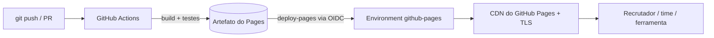

# 02 — Discussão técnica: GitHub Pages no nível DevOps/SRE sênior

O júnior vê o Pages como "hospedagem grátis de HTML". O sênior o vê como uma **CDN estática gerenciada, integrada ao Git e ao sistema de identidade do GitHub (OIDC)**. Isso a torna o destino natural de tudo o que um pipeline produz e que precisa ser lido por pessoas ou ferramentas.

## 1. Arquitetura



- **Imutável e atômico:** cada deploy é um artefato novo. Para fazer rollback, basta re-executar o workflow de um commit anterior.
- **Sem servidor:** não há SO para manter nem porta aberta, e a superfície de ataque é mínima.
- **Identidade:** o `deploy-pages` troca o token OIDC do job por permissão de publicação. Não existe PAT nem segredo de longa duração.

## 2. Segurança da cadeia de publicação

| Controle | Por quê |
|---|---|
| `permissions:` mínimas no workflow | o `GITHUB_TOKEN` só recebe o que precisa |
| Environment `github-pages` com *deployment branch rule* = `main` | branch de feature não publica em produção |
| Fixar actions por **SHA** (ex. `actions/checkout@<sha>`) com Dependabot atualizando | evita ataque de supply chain por tag movida |
| `deploy` só depois de `build` com testes | quality gate antes de publicar |
| Verificação do domínio na conta | previne *subdomain takeover* |
| CSP via `<meta http-equiv>` | o Pages não permite headers HTTP customizados |
| Nunca publicar segredo | site de repo público é público. Pages privado (com controle de acesso) só existe no GitHub Enterprise Cloud |

> **Tema de entrevista:** "Como você publicaria docs internas sem expor nada?" Resposta sênior: Pages privado no Enterprise Cloud, ou S3 + CloudFront com autenticação (OIDC/SSO no edge), ou um portal como o Backstage TechDocs.

## 3. Limites oficiais (e o que eles ensinam)

| Limite | Valor |
|---|---|
| Tamanho do site publicado | até 1 GB |
| Repositório fonte | recomendado até 1 GB |
| Tempo de deploy | timeout após 10 min |
| Banda | limite *soft* de 100 GB/mês |
| Builds | limite *soft* de 10/hora; não se aplica a workflow customizado do Actions |

Fonte: [GitHub Pages limits](https://docs.github.com/pages/getting-started-with-github-pages/github-pages-limits). O Pages **não é** para e-commerce, SaaS ou tráfego comercial pesado. Saber o limite da ferramenta e quando migrar faz parte da senioridade.

## 4. Trade-offs: quando NÃO usar

| Precisa de… | Pages resolve? | Alternativa |
|---|---|---|
| Headers customizados (HSTS, CSP, CORS) | não | Cloudflare Pages, S3 + CloudFront |
| Redirect 301 no servidor | não (só `404.html`/meta refresh) | CloudFront Functions, Netlify `_redirects` |
| Preview por PR | não nativo | publicar o artefato do PR em Cloudflare/Netlify, ou baixar o artefato |
| Backend, formulário, autenticação | não | API serverless + site estático |
| Controle total de região/compliance | não | S3 + CloudFront via Terraform/Crossplane |

## 5. Onde o Pages ajuda um DevOps/SRE no dia a dia

### 5.1 Docs-as-code: runbooks, postmortems e ADRs
Runbooks em Markdown no mesmo repo do serviço, revisados por PR e publicados com MkDocs Material ou Docusaurus. Assim a documentação muda **junto** com o código, e o link do alerta (`runbook_url` no Prometheus) aponta para uma página versionada.

```yaml
# regra de alerta Prometheus
annotations:
  runbook_url: https://<org>.github.io/payments/runbooks/high-error-rate/
```

### 5.2 Repositório de Helm charts
O [chart-releaser-action](https://github.com/helm/chart-releaser-action) empacota os charts, cria GitHub Releases e mantém o `index.yaml` na branch `gh-pages`:

```bash
helm repo add minha-org https://<org>.github.io/charts
helm install api minha-org/api
```

Com isso você tem um repositório Helm sem servidor, com histórico auditável no Git.

### 5.3 Status page
O [Upptime](https://github.com/upptime/upptime) usa o Actions para checar endpoints, registra incidentes como issues e publica a status page no Pages. É uma forma barata de demonstrar SLI de disponibilidade no portfólio.

### 5.4 Relatórios de pipeline
- Cobertura de testes, relatório de testes e2e (Playwright) e SBOM navegável.
- Histórico de benchmarks com o [github-action-benchmark](https://github.com/benchmark-action/github-action-benchmark), que gera gráficos no `gh-pages` e alerta sobre regressão de performance.
- Docs de módulos Terraform geradas com `terraform-docs` e docs de API com OpenAPI/Redoc.

### 5.5 Portfólio que se atualiza sozinho
É o padrão de [passosjoy.github.io](https://github.com/passosjoy/passosjoy.github.io): um gerador lê a API do GitHub e transforma cada repo público com o topic `portfolio` em um artigo. O workflow roda em `schedule`, em `workflow_dispatch` e em `repository_dispatch`. O conteúdo deixa de ser mantido à mão e passa a ser **derivado da fonte da verdade**, o mesmo princípio de GitOps.

## 6. Como discutir isso numa entrevista sênior

- **Decisão:** "Escolhi Pages + Actions porque o requisito era custo zero, sem operação e com HTTPS. Aceitei não ter headers customizados e mitiguei com CSP via meta."
- **Segurança:** "O deploy usa OIDC, sem segredo; as permissões são mínimas e as actions ficam fixadas por SHA."
- **Confiabilidade:** "O deploy é atômico e o rollback é re-rodar um commit. Os links quebrados são barrados no PR."
- **Escala:** "Se o tráfego passar de 100 GB/mês ou eu precisar de headers e preview por PR, migro para S3 + CloudFront com IaC, e o pipeline de build continua o mesmo."
